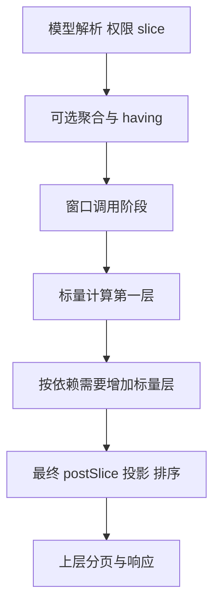

# 窗口计算字段依赖与分阶段执行实施方案

本方案处理 #142 中窗口字段可执行，但依赖它的差额、比率结果错误的问题。复用现有表达式解析、依赖排序、QueryStagePlan、ResultStagePlan 和结果 SQL 渲染器，补齐字段身份、跨阶段绑定及窗口后的标量计算。不能只传播 hasWindow 标志，也不另建并行执行引擎。

2026-10-20 用户认可方案并要求落档及 review。本轮仅整理文档，不修改引擎源码或测试；后续实施顺序仍为 #140/#141、#142，分别验收。配套[核心流程 review](REVIEW-142-window-calculation-core-flow.md) 的必要调整已经纳入本方案。`v3.0` 为仓库归档目录，不承诺发布版本。

同日已核对 [issue 最新补充](https://github.com/foggy-projects/foggy-data-mcp-bridge/issues/142)“执行前校验与面向 AI 的可修正诊断”（GitHub updatedAt 为 2026-10-19T17:56:35Z，即北京时间 2026-10-20 01:56:35）。补充不改变支持窗口依赖的目标，增加了执行入口强制校验、结构化诊断传递及按建议修正后再执行的验收，见第 5.3 节。

## 1. 问题与修复边界

issue 请求先按 invoiceDate$yearMonth 聚合 invoiceAmount，再计算 previousAmount = lag(invoiceAmount, 1)、difference = invoiceAmount - previousAmount、changeRatio = (invoiceAmount - previousAmount) / nullif(previousAmount, 0)。期望 2012 年 11 月金额 37.62、前序金额 42.62、差额 -5、比率约 -0.1173158142；issue 报告差额为 37.62 且比率未正常返回。

当前依赖排序解决了解析顺序，但引用计算字段时会展开 getDeclare，无法保证消费者位于生产者后的 SQL 层。复合窗口表达式还可能将 OVER 拼到整个算术表达式后。SQLite 对部分未解析双引号标识符的兼容行为会掩盖错误，因此不能把“SQL 执行成功”视为计算正确，也不能只针对 SQLite 修复。

本次范围：普通 query_model calculatedFields 的窗口及其下游标量依赖链、内嵌窗口表达式、明确的聚合别名引用，以及这些能力所必需的验证、投影、参数、过滤和总数一致性。现有显式 DSL_CTE、Compose 窗口算子作为保护性回归对象，不替换其前端协议。

不新增：窗口套窗口、窗口后重新聚合、任意 postAggregateCalculations 混用、自动补期间、跨数据源计算或新的财务日历。原有无窗口计算行为保持兼容；不能因本次规划器覆盖范围有限而统一禁止原本支持的表达式。

## 2. 语义不变量

1. 每个引用绑定到确定的字段身份和生产阶段；跨阶段引用只读已产出的列，不重新展开原始公式。
2. 分组查询中的度量在聚合层按模型或显式聚合定义计算一次；窗口输入是聚合结果。明细窗口仍读取行级值，不强制增加 GROUP BY。
3. 不为隐藏依赖新增分组键、改变 DISTINCT 或放宽字段权限。分组窗口的分区/排序引用必须能在当前粒度表达，否则报错。
4. 同一 SELECT 层的计算列不能依赖同层另一个新别名；依赖层级决定额外 SQL 边界。
5. 窗口计算不会改变行数；标量投影不会改变粒度。slice、having、postSlice 各自保持输入过滤、聚合过滤、最终结果过滤语义。
6. 排序和分页位于最终结果层；窗口 orderBy 只控制窗口运算，不替代最终 orderBy。
7. 默认首行 prior/difference/ratio 为 null；prior 为零时 difference 正常、NULLIF 比率为 null。显式 emptyDefault/COALESCE 按用户表达式执行，不偷偷补零。
8. 类型推导保留小数除法、金额精度和可空性。字段 schema 与实际最终投影一致，隐藏列不进入公共响应。
9. validate、explain、execute 使用一致的已解析计划，保留各自治理动作和副作用边界。
10. MAIN 与 TOTAL 从同一逻辑图派生。returnTotal 行数与 totalData 指标总计是不同合同，不能因为支持窗口链就自动允许差额或比率求和。

## 3. 首批能力矩阵

| 请求形式 | 目标规则 |
|---|---|
| lag(invoiceAmount, 1) | 保留支持；分组时绑定当前聚合粒度的度量，明细时绑定行级列 |
| previousAmount → difference → changeRatio | 完整支持多级标量依赖；定义顺序不影响结果 |
| invoiceAmount - lag(invoiceAmount, 1) | 支持；将窗口调用提取为内部字段，在后续标量层做减法 |
| 多个独立窗口 | 同层执行，各自保存 partition/order/frame；不强制相同窗口规格 |
| lag(totalAmount, 1)，totalAmount 为选中聚合别名 | 定向支持唯一且可解析的别名，窗口下游标量可继续引用它 |
| lag(sum(invoiceAmount), 1) | 在本次普通 calculatedFields 分组后窗口入口拒绝重复聚合；优先提示经口径验证的 lag(invoiceAmount, 1)，或当前版本实际支持的显式聚合结果引用，不把此限制推广为所有 SQL/DSL_CTE 规则 |
| 窗口依赖另一个窗口的结果 | 首批拒绝，包括经标量字段间接依赖；不隐式生成第二轮窗口 |
| 窗口结果再次聚合或重新分组 | 首批拒绝 |
| 与 postAggregateCalculations 任意混合 | 保留既有能力边界和拒绝规则，不全面开放 |
| 未支持窗口能力的数据库 | 编译期明确拒绝；不以单层查询降级 |
| 有窗口但缺 CTE 的方言 | 首批保留现有能力限制；不借通用 renderer 的 derived 能力自动放开 |

同一个字段的外部 window 规格作用于该表达式中允许的窗口调用节点，不作用于减法、除法或 NULLIF。函数分类必须区分标量函数、普通聚合及窗口调用；不根据字符串包含函数名推断。多个窗口节点规格相同时可以复用内部产出，但首批不要求做公共子表达式优化。

对于 LAG/LEAD，要求明确的窗口排序。排序键不唯一时结果可能不稳定，应提供稳定的并列排序字段；引擎不能擅自补事实主键而破坏聚合粒度。RANK 等函数的并列语义应保留，不能统一强制唯一排序。frame 的函数适用性、默认值和参数限制继续按已有函数/方言合同验证。

## 4. 字段身份与依赖绑定

### 4.1 复用结构并补充语义

沿用 ResultStagePlan.Column 中的 alias、role、producerStageId、lastConsumerStageId、type、sourceLineage、BoundSqlExpression。解析期间还需记录符号身份、直接依赖、表达式 AST、操作类别和输入粒度；可增加请求内解析结构，不建立另一份独立阶段拓扑。

操作类别至少区分源字段、普通聚合、窗口调用、标量计算。`hasWindow` 可以继续用于兼容诊断，但不能作为执行阶段的唯一依据。“内部含窗口调用”与“只依赖窗口结果”是不同情况。

先收集并绑定字段定义，再拓扑排序和规划阶段，最后按实际输入 schema 渲染表达式。对已有简单表达式路径提供适配，避免所有表达式一次性迁移。

### 4.2 绑定规则

- 依赖包括表达式、partitionBy 和 windowOrderBy；frame 若仅允许字面边界则不制造字段依赖。
- 选中聚合别名注册为聚合输出符号。明确区分模型属性、内联聚合别名、用户计算字段，不能靠解析先后覆盖同名定义。
- 同名冲突、未知符号和跨粒度引用在生成 SQL 前拒绝；保持已有内联聚合别名的合法兼容规则。
- 自引用检查在身份绑定后执行：模型字段同名引用不等于计算字段自循环。错误信息提供实际依赖链，不把所有未排序节点都断言为循环成员。
- 原始度量可绑定到已存在的等价聚合输出，或添加隐藏聚合输出；等价性需包含函数、distinct、表达式和类型，不只比较名称。
- 多个聚合口径不明确时要求引用显式别名，不猜选 SUM/AVG。只有模型默认口径明确时才按既有规则解析原始度量名。
- 计算依赖、过滤和排序引用都经过字段访问治理；隐藏不代表免检。

## 5. 阶段规划与 SQL 生成

建议增加中性的 `RESULT_CALC_STAGE` 类型表达窗口后的标量投影，不复用当前带特殊 postAggregateCalculations 含义的 POST_AGGREGATE_STAGE。多个标量层使用唯一 stageId，QueryStagePlan 与 ResultStagePlan 保持一一对应。类型名为实现建议，实施中可调整命名，但不能改变阶段含义。

两个独立的 difference、changeRatio 直接依赖金额和 prior 时可同层。若 changeRatio 引用 difference，则再增加标量层。第一版不跨层内联以减少 CTE；待正确性稳定后再讨论物理优化。

窗口函数必须先在 AST 中识别并提取，OVER 绑定到函数节点。跨阶段字段引用使用输入关系限定的逻辑列；不要继续依赖对物理 SQL 字符串进行正则替换。

### 5.1 隐藏列与过滤

从最终输出、postSlice、最终 orderBy 反向计算依赖闭包。即使没有公开选择 previousAmount，也要生成其窗口节点；不允许“没有公开窗口字段”触发单层降级。

lastConsumerStageId 包括表达式消费、最终过滤、排序和必要的总数路径。只在计算阶段使用的列可在该阶段投影后丢弃；被最终 WHERE 使用的列必须传到最终层，不能在窗口层提前删除。

首批 postSlice 统一定义为全部结果计算完成后的过滤；不下推窗口之前。现有 renderer 收集阶段 filters 后统一放到最终层，应明确记录最终过滤归属，保证诊断与执行一致。若现有接口要求中间过滤而当前路径不能正确表达，明确拒绝；不在本次自动开放任意阶段过滤。

### 5.2 参数、总数与失败处理

所有新增阶段表达式携带 BoundSqlExpression；参数顺序与渲染顺序一致。禁止渲染后用只含 SQL 文本的工厂替代带参数表达式。参数缺失、重复或占位数量不一致必须在执行前检测。

行数统计基于最终过滤后、分页前的关系。新增阶段类型需同步进入 QueryStagePlan 的最终 SQL 保留策略、预聚合计数等价判断，不能绕过 postSlice 后仍使用基础行数。既有 totalData 聚合状态、AVG 和 distinct 合同独立保持，不将窗口派生值直接当成可加总指标。

保留仅在语义等价时执行的单窗口物理折叠；存在下游依赖、隐藏窗口、过滤或额外标量层时不能折叠掉必需边界。计划和准备结果不一致属于编译错误，不能静默回退 single-pass。

### 5.3 执行前校验与可修正诊断

校验必须覆盖最终执行计划的字段可用性、阶段依赖、粒度和 OVER 绑定，不以 JSON 合法或表达式可解析为终点。query.execute 必须自行通过同一规划校验，不能依赖调用者之前做过 query.validate，也不能用历史 validate 结果替代当前权限/模型快照下的准备过程。

已识别的非法规划必须返回失败；不得通过 warning 后继续返回 success=true、遗漏字段或不可信数值。拒绝发生在 JDBC 业务查询之前，包括主查询与总数查询；元数据加载与合法治理检查不等于执行业务查询。explain 使用同一能力检查，不能展示看似可执行的错误计划。

复用现有 RuntimeError 与 RuntimeDiagnostics.attributes，避免新建公共错误协议。内部可以使用携带结构化规划诊断的类型化异常/结果，但必须贯穿表达式异常包装、SemanticQueryService、Runtime API 和 explain 映射；不能在中途只保留 e.getMessage() 再按字符串猜错误码。现有 QueryInputWarning 的字段组织可参考，其输入属性告警语义不能直接作为本次阻断错误的替代。

诊断至少包含以下信息：

| 信息 | 合同 |
|---|---|
| code | 稳定、区分原因的错误码；实施时核对已有注册，避免冲突 |
| phase | 本次规划校验失败为 query.validate；直接 execute/explain 的请求操作另存 diagnostics.attributes.requestOperation，不冒充数据库执行失败 |
| field / path | 用户字段名与原始 Query DSL 路径，例如 difference、$.calculatedFields[1].expression |
| 依赖与阶段 | diagnostics.attributes 中记录消费者、依赖字段、生产阶段、所需阶段及拒绝原因，只使用逻辑公开名称 |
| suggestedNextAction | 依据当前入口、版本、方言实际能力给出的可执行建议，保留原范围、分组与排序 |
| safeToAutoRepair | 仅在可以证明修正保持语义、且修正后入口确实支持时为 true；需要换阶段、改调用方式或确认意图时为 false |

路径基于原始请求的 Query DSL 部分：兼容现有 payload/request 包装的路径归一化约定；在拓扑排序、内联别名归一化和隐藏窗口提取之前保存来源路径，不用排序后的下标或内部生成字段定位用户错误。多个错误可放入 diagnostics.attributes.violations；摘要错误指向第一个确定的阻断项。

建议的诊断类别如下，代码名为拟定名称，实施前需核对现有错误码合同：

| 拟定代码 | 原因与修正原则 |
|---|---|
| WINDOW_STAGE_REAGGREGATION_UNSUPPORTED | 当前分组结果已聚合，LAG 内再次 SUM 会改变粒度；仅在模型聚合口径一致时建议 lag(invoiceAmount,1)，否则要求明确已支持的聚合输出引用 |
| WINDOW_OVER_BINDING_UNSUPPORTED | 当前入口无法把窗口规格绑定到表达式中的具体调用；只有后续阶段实际可用时，才建议拆成窗口字段和后续标量 |
| WINDOW_RESULT_DEPENDENCY_UNSUPPORTED | 依赖 WINDOW 输出但当前能力无法安排后续阶段；提供当前已支持派生入口的最小写法，否则明确限制，建议先返回本期/上期金额再由计算工具求差额和比例 |

本次目标支持内嵌窗口和普通窗口下游标量，因此原 issue A/B 在满足支持规则时应成功，不应为了满足“拒绝测试”而永久禁止它们。上述错误用于仍未支持的组合或明确受限入口；已声明支持但计划产出不一致属于内部规划错误，应失败并提供排查标识，不能伪装成用户写法错误要求改业务条件。

诊断不得建议物理 SQL、内部 stage 参数、未公开字段或当前版本仍拒绝的 lag(totalAmount,1)。不支持下游阶段时，“拆出 previousAmount 后继续同层引用”不是有效修复。需要改调用方式的 fallback 标记 safeToAutoRepair=false；返回金额交给计算工具也不能被描述为引擎已经完成原请求。

对局部修正也不能一律自动修复。例如移除 LAG 参数内的 SUM，只有确认基础阶段已有相同 SUM 口径、粒度和 null 语义时才可标记 true；此标记仅描述可修复性，不授权引擎静默改写请求。诊断中保留逻辑字段与依赖信息，继续应用错误脱敏，不能返回物理表列、原始 SQL 或敏感输入值。合法首行 null 不属于诊断错误。

## 6. 类与职责调整

| 类或模块 | 改造职责 |
|---|---|
| CalculatedFieldService | AST 依赖收集、窗口规格依赖、绑定后的拓扑与循环诊断 |
| SqlCalculatedFieldProcessor | 从表达式整体包装转为窗口节点识别；保留默认值和类型合同 |
| SqlColumnRefExp、SqlExpContext、SqlFragment | 输入符号绑定、阶段列引用、参数和类型传递；减少 SQL 字符串回写 |
| CalculatedDbColumn | 适配已解析字段元数据，避免用两个布尔标记代替阶段语义 |
| QueryRequestValidationStep | 定向允许已规划聚合别名引用，检查不支持的嵌套和混用 |
| SemanticQueryServiceV3Impl、表达式异常包装与查询错误映射 | 保留类型化规划诊断，直接执行也经过最终校验，内部错误与输入错误分开 |
| RuntimeQueryController、RuntimeQueryExplainController、RuntimeApiResponseFactory | 优先映射结构化规划失败，保留路径、建议、阶段和自动修复标记；不降级为通用失败码 |
| RuntimeError、RuntimeDiagnostics | 复用现有字段与 attributes，不新增公共顶层错误协议；检查序列化和 CLI 可见性 |
| QueryStagePlanner、QueryStagePlan、QueryStageType | 依赖决定标量层，统一能力判断、过滤归属及总数优化策略 |
| ResultStagePreparationFactory | 根据完整依赖闭包生成实际输出，计算各列生命周期 |
| ResultStagePlan | 复用现有结构，补输入可用性、跨阶段引用与输出一致性校验 |
| ResultStageRenderer | 支持标量层，维护参数和列存活，约束折叠优化和最终过滤 |
| JdbcModelQueryEngine | 由完整准备计划驱动基础投影和最终输出，去除公开窗口列数量驱动的静默降级 |
| totalData 相关模块 | 保护现有能力；仅当新阶段接入暴露缺口时作定向修正，不新增总计语义 |

## 7. 与其他 issue 的接口

[#140/#141 方案](BUG-140-141-timewindow-comparative-plan.md) 负责日历期间键、当前/比较范围、关联粒度及公共执行接缝；#142 负责普通窗口计算的字段可用性和结果阶段。两者共享治理上下文、真实输出 schema、最终编译一致性及分页/总数约束，不合并为一轮通用规划器重写。

LAG 表示前一结果行，timeWindow 表示指定日历期间。1 月和 3 月之间缺少 2 月时，LAG 可取 1 月；月环比应找 2 月并得到 null。普通窗口 slice 排除了去年 12 月，1 月 LAG 就不能自动读取它；#142 不扩大源范围。周、季度、DateTime 的期间算法属于 #140/#141，不复制进窗口依赖解析。

#139 已在当前分支提交 f0deb244 中修复执行 namespace 传递；此处只记录代码基线，未重新验证该修复。后续复用其执行路由，不重复实现。

## 8. 分步实施与退出条件

| 步骤 | 内容 | 退出条件 |
|---|---|---|
| S0 | 建立原 issue 数值夹具和失败测试，冻结普通窗口与 totalData 已有行为 | 能定位错误阶段，覆盖 12 行、差额及比率，不只测 SQL 执行成功 |
| S1 | 字段身份、原始路径、依赖收集、聚合别名绑定、循环和能力验证 | 打乱定义顺序无影响；歧义与不支持输入在 validate 拒绝，诊断指向原始位置 |
| S2 | 提取窗口节点、生成隐藏输出、建立阶段引用 | 内嵌窗口与显式窗口字段得到等价逻辑图，聚合只发生一次 |
| S3 | 接入多层结果计算、投影生命周期与 renderer | 只选末端字段、过滤专用/排序专用字段及参数均正确 |
| S4 | 对齐验证/解释/直接执行、结构化诊断、MAIN/TOTAL、方言与优化边界 | 阶段图与 SQL 一致；非法规划不进入 JDBC 业务查询，诊断保真且修正建议有效 |
| S5 | 运行定向测试、仓库集成通道和数据库矩阵，回归 #140/#141 | 真实 SQL 数值对照通过，记录方言能力拒绝与未运行项目 |

S1～S4 可以分提交，但隐藏依赖和静默降级修复不能被留到一个已宣称支持依赖链的版本之后。#140/#141 完成公共准备入口后，本方案接入同一入口，不再写第二套 validate 编译逻辑。

## 9. 回归测试范围

| 层次 | 必须覆盖 |
|---|---|
| 身份与依赖 | 正序/倒序定义、多级链、真正自环/互环、未知引用、名称冲突、分区/排序依赖、聚合别名歧义 |
| 阶段与投影 | 窗口后两层标量、只选差额、只选比率、过滤专用和排序专用依赖、实际输出 schema、隐藏列生命周期 |
| 函数与类型 | LAG/LEAD 与已有排名/累计能力、NULLIF、显式默认值、金额精度、整数比率、frame 检测一致性 |
| 聚合 | SUM/COUNT/AVG/COUNT DISTINCT，多个聚合口径，明细窗口不被分组，分组窗口不加入额外事实键 |
| 数据边界 | 首行、零值、null、空结果、单行、多分区、跨年、缺月、日期与时间戳排序 |
| 过滤和执行 | slice→having→窗口→标量→postSlice；最终排序与窗口排序不同；limit/offset；参数数量和值顺序 |
| 总数与总计 | postSlice 前后行数差、分页前总数、AVG 状态与既有 totalData 拒绝规则、不能直接加总 ratio |
| 治理与入口 | 隐藏依赖权限、namespace、validate/explain/execute 同构、真实响应字段/null 合同 |
| 拒绝与诊断 | 同一非法请求分别 validate/直接 execute/explain；稳定代码、校验 phase、原始路径、依赖原因、有效建议和 safeToAutoRepair；验证主查询与总数查询均未进入 JDBC |
| 修正闭环 | 按返回建议构造最小修正请求，重新 validate 与执行并核对数值；断言日期范围、分组、分区/排序未改变；需要换入口的建议不得标记自动修复 |
| 兼容路径 | 无窗口 calculatedFields、已有 postAggregateCalculations、DSL_CTE、Compose outer window、#140/#141 timeWindow |
| 数据库 | SQLite 原问题回归及仓库已支持窗口方言的结果对照；无能力方言显式拒绝 |

优先扩展 CalculatedFieldServiceTest、JdbcModelQueryEngineStagePlanTest、ResultStagePlanContractTest、ResultStagePreparationTest、ResultStageRendererTest、JdbcModelQueryEngineCteWrapTest；新增普通 query_model 窗口依赖的真实 SQL 集成用例。DslCteResultStageWindowIT 用于保护显式阶段路径，不能代替普通 calculatedFields 的验收。

实施时按仓库 scripts/verify-v934-unit.sh、verify-v934-integration.sh、verify-v934-database-matrix.sh 的实际 runner 合同执行。定向调试测试和正式验收分开记录；不能用默认跳过 IT 的构建结果宣称集成通过。测试对照手写 SQL 和固定业务数值，并验证实际公共响应；快照检查作为补充，不作为唯一正确性依据。

诊断验收必须覆盖 Runtime API 与 CLI 消费的真实 envelope，不能只在 planner 单元测试断言异常消息。简单 LAG 的 12 个月正例、83 行明细和含上年 12 月的 13 个月正例作为补充保护，避免通过禁用函数本身绕过组合错误。修正闭环覆盖“可保语义局部调整”与“需换阶段/入口”两类，不能仅验证建议文本含某个关键词。

## 实施进展（2026-10-20）

此前“仅讨论/未实施”的文字为方案阶段记录；用户已授权统一实施，当前状态以本节和后续验收记录为准。

窗口调用已通过 WindowExpressionLowering 在 AST 中提取；窗口产出与依赖它的标量计算分层执行。依赖收集包含表达式、partitionBy 和 windowOrderBy，保留原始 calculatedFields 路径；循环成员与仅受阻的下游字段分开报告。结果阶段按公开输出、过滤、排序反向收集隐藏依赖，postSlice 明确归属最终阶段，MAIN 与 TOTAL 使用同一过滤行集。

QueryCalculationException 已贯通 Runtime 查询和 explain 错误映射。非法计划同时在 validate 与直接 execute 阻断；新增真实 JDBC 探针验证不准备业务 MAIN/TOTAL SQL，并按聚合别名建议完成修正后的数值验收。普通 LAG、复合窗口算术、多层标量、零分母、业务分区、12/13 个月和 83 行明细均加入验收。Compose 的多 CTE 引用使用 CteAliasScope 逐层改名，保护字符串与参数顺序。

必需后端全量测试已通过。完整结果、初轮问题的收尾修复和现行门禁见 [最终验收记录](VERIFICATION-140-141-142.md)；不将实际 Maven 执行结果冒充历史发布门禁通过。

## 最终验收（2026-10-20）

实现与本次必须合并的核心流程调整已完成。Windows/Linux 全量单测各 5,842 项，均无失败和错误；常规集成、五库矩阵及外部服务共 926 次测试执行，零失败、零错误、零跳过。后续收尾已修复 Viewer E2E 失配、补跑真实 MySQL 浏览器链路（5/5、零跳过），并恢复两个源码扫描的正式 JUnit 执行。当前版本沿用 current-main 本地验收门禁，V934 历史清单保持原样。详见 [最终验收记录](VERIFICATION-140-141-142.md)。
