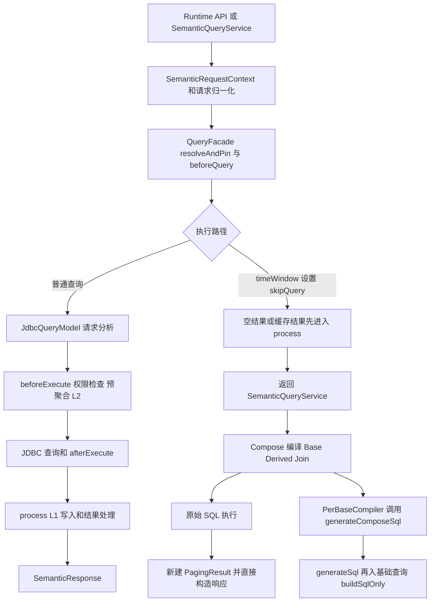

# 查询引擎核心流程 review 与 timeWindow 修复边界

本 review 在 [#140/#141 实施方案](BUG-140-141-timewindow-comparative-plan.md) 初稿落档后进行，覆盖 Runtime 查询入口、请求上下文、QueryFacade 生命周期、timeWindow 计划接管、Compose 基础分支编译、JDBC 受管准备、执行及结果封装。重点是决定哪些调整应随本次修复，不能据此宣称已审计引擎所有算子或证明所有权限/缓存路径安全。

结论：现有计划 AST 与 SQL 编译框架可以保留；本次应修复 timeWindow 与核心管线的接缝。除期间算法外，必须覆盖完整请求上下文、最终编译入口、延迟执行结果的处理时序和公共输出。新增风险证据为源码静态分析，未执行漏洞复现、数据库测试或性能基准；以下区分已确认的代码行为与需要测试确认的影响。

2026-10-20 后续决策：用户确认 ISO 周同比同周号、缺少对应第 53 周返回 null、非整周期首批拒绝、[] 包含结束自然日。日期维度与普通 DATE/DATETIME 属性统一接入的要求已补入实施方案。用户要求讨论完成 #142 后再统一开工，目前不实施本 review 中的代码调整。

同日补充：[#142 实施方案](BUG-142-window-calculated-field-stage-plan.md)及[依赖与结果阶段 review](REVIEW-142-window-calculation-core-flow.md)已落档。后续由本工作项提供公共准备、上下文和结果生命周期修正，#142 接入该基础并补齐窗口依赖，不重复构建执行管线。本 review 的源码证据仍对应头部 source_commit；当前分支已新增 #139 的 f0deb244 路由修复，本轮未重新进行其运行时验收。

## 1. 当前核心流程

validate 当前停在 buildSqlOnly；timeWindow 接管时这里返回空 SQL。generateSql/explain 则另行编译 timeWindow 计划，execute 又独立构造 Compose 上下文。因此三入口并未完全共享最终准备过程。

## 2. 发现与处置总表

| 编号 | 优先级 | 已确认行为 | 本次处置 |
|---|---|---|---|
| R01 | P1 | 进入 Compose 时重建请求上下文，遗漏原请求信息，执行与预览 Principal 不一致 | 必须合并 |
| R02 | P1 | timeWindow 的空占位结果先 process，真实结果在外层执行后没有同一路径的 process | 必须合并，缓存影响需定向测试 |
| R03 | P1 | validate 不编译最终计划；直接复用现有 Compose 编译又会将动作设为 EXECUTE | 必须合并 |
| R04 | P1 | timeWindow 计划/列清单/schema 分别推导；时间字段 fallback 弱化校验 | 必须合并 |
| R05 | P2 | 执行后 total=rows.size，start/limit 未同步到新建 PagingResult | 必须修正分页封装，不扩大总计能力 |
| R06 | P1 | 基础 Compose 编译走 generateSql，不走已存在的 PREPARE_MANAGED_RELATION 步骤 | 必须增加安全准备一致性用例；如缺保护则补受管入口 |
| R07 | P2 | 周截断方言实现不完全等价；父类截断为 no-op | 支持周规则时必须解决，不全局重写方言 |
| R08 | P2 | IT 默认跳过，快照月度请求主动带日级键 | 必须修正测试合同并接入实际执行通道 |
| R09 | 观察 | PlanHash 已包含 slice，预聚合已有周与月不可直接层级聚合规则 | 保护性回归，不先改缓存/预聚合框架 |

P1/P2 是本次修复优先级。R01/R06 涉及治理边界，但本文不将未经执行验证的路径差异直接表述为已确认越权。

## 3. R01 请求上下文在 Compose 桥接处被缩减

证据：

- [SemanticQueryServiceV3Impl](../../../foggy-dataset-model-engine/src/main/java/com/foggyframework/dataset/model/semantic/service/impl/SemanticQueryServiceV3Impl.java) 280—295 行，execute Principal 只有 userId/deptId/tenantId；1189—1225 行的编译 helper 另外带 roles 和 authorizationHint。
- 同文件 642—668 行，普通 ModelResultContext 原本携带 requestIdentity、permissionSession、fieldAccess、deniedColumns、systemSlice、catalogResolution、executionBundlesContext、explainTraceCollector。
- [ComposeSqlCompiler](../../../foggy-dataset-model-engine/src/main/java/com/foggyframework/dataset/model/engine/compose/compilation/ComposeSqlCompiler.java) 111—126 行从 Principal 新建 SemanticRequestContext，未携带上述完整原上下文。
- [PerBaseCompiler](../../../foggy-dataset-model-engine/src/main/java/com/foggyframework/dataset/model/engine/compose/compilation/PerBaseCompiler.java) 271—285 行将 ModelBinding 的治理字段应用到新上下文。timeWindow 当前 resolver 提供的是空 ModelBinding；不能假设最外层原治理条件会因此自动继承。

影响：执行和 explain 身份可能不同；基础分支可能重新解析模型而失去请求固定快照；外部明确传入的行列约束存在丢失风险。后续步骤是否重新补齐部分权限需要以受保护模型验证，不能只测试匿名 Chinook。

建议：timeWindow 桥接显式携带请求级上下文/绑定，不用 Principal 做有损 round-trip。单模型两分支沿用同一 CatalogResolution、PermissionEvaluationSession、身份与动作，保留原始治理条件，再合并合法的每模型约束。不要对整个跨模型 Compose 直接复用一个单模型 CatalogResolution；通用 Compose 的每模型绑定仍需独立。

验收：相同 payload 的 validate/explain/execute 保留角色、opaque Authorization、额外权限属性；注入 systemSlice/fieldAccess/deniedColumns 后两分支均受约束；编译中途刷新模型时仍使用同一固定实例。原始凭据不写入计划日志或诊断。

## 4. R02 skipQuery 混合了缓存命中和延迟计划执行

证据：

- [QueryFacadeImpl](../../../foggy-dataset-model-engine/src/main/java/com/foggyframework/dataset/model/service/impl/QueryFacadeImpl.java) 166—174 行对所有 skipQuery 创建占位结果并调用 process。
- SemanticQueryServiceV3Impl 275—308 行随后执行 timeWindow 原始 SQL，新建 PagingResult；315 行直接 buildResponse，没有回到相同 process 阶段。
- [L1CacheStep](../../../foggy-dataset-model-engine/src/main/java/com/foggyframework/dataset/model/plugins/result_set_filter/L1CacheStep.java) 的 process 在 L1 启用、有有效授权签名、未命中且 result 非 null 时写缓存；代码不区分 timeWindow 占位结果。
- 同一 step 的 beforeQuery 命中也设置 skipQuery。timeWindow 计划标记若仍存在，外层检查没有以缓存命中排除再次执行。

已确认的是处理时序与状态复用；“写入空结果”和“命中后仍执行”的具体触发需真实缓存 provider/spy 测试，不能从默认 NoOp provider 推断生产必然表现。

建议：增加最小的类型化执行状态，区分已有结果、普通执行、待执行比较计划。保留现有入口适配，但 pending plan 不进入结果 process。真实执行结果回填同一个 ModelResultContext 后，执行已支持的 process 恰好一次；缓存命中不得再执行计划。SQL-only 路径不能触发结果缓存读写或效果步骤。

注意：不能仅在外层补一次 process。否则仍有占位结果提前处理、双重处理问题；也可能首次启用之前未生效的 withSubtotals。比较比例不可直接相加，必须按输出语义控制后处理资格；未定义的小计组合应明确诊断并记录兼容变化，不新增隐含错误总计。

## 5. R03 最终编译与权限动作必须一起修

QueryFacadeImpl 237—243 行明确将最终计划编译交给调用方；SemanticQueryServiceV3Impl 1259 行 validate 调用后直接构造响应。该缺口已被 #140 的 validate 成功、explain 失败证明。

同时 ComposeSqlCompiler.semanticRequestContext 硬编码 PermissionAction.EXECUTE。若只是让 validate 调用现有 helper，会改变 validate 的权限动作。

当前 RuntimeQueryController 为 validate/execute 分别设置 VALIDATE/EXECUTE；RuntimeQueryExplainController 在带 payload 时按 EXECUTE 授权，当前并没有 EXPLAIN 枚举。新实现应保持这个现有合同，不凭空新增动作。

建议：抽取共用的 prepared comparative query，包含最终计划/SQL、参数、实际 schema、诊断及请求级上下文。validate 按 VALIDATE 构建最终结构；explain 沿现有 EXECUTE 授权但禁用数据执行与缓存；execute 在完成同样结构编译后执行。分别调用 API 是不同请求，不承诺跨调用复用同一快照或授权决定。

验收：对缺字段/非法粒度等结构错误，三入口诊断一致；权限动作可以按现有合同不同。spy 确认 validate/explain 没有业务 JDBC 查询和结果缓存写入。

## 6. R04 时间轴解析和输出必须有唯一依据

证据：

- [TimeWindowInterceptor](../../../foggy-dataset-model-engine/src/main/java/com/foggyframework/dataset/model/plugins/result_set_filter/TimeWindowInterceptor.java) 79—81 行将用户传入 field 无条件加入 availableFields 和 timeFields，使该层 field-not-found/field-not-time 检查失去部分作用。
- [TimeWindowExpander](../../../foggy-dataset-model-engine/src/main/java/com/foggyframework/dataset/model/engine/compose/plan/TimeWindowExpander.java) 的 expandComparative、getOutputColumns、getOutputSchema 独立维护周期分支；同比 year/week 落入 dayOfYear。
- TimeWindowInterceptor 205—208 行将原请求列直接追加到“可用输出列”集合，随后据此构建后置计算投影。不能保证这些列真的由比较计划产生。
- applyFinalControls 以空 columns 包装排序/分页，没有单独恢复用户要求的最终投影列表。

建议：由解析后的时间轴/期间结果构造计划；再从实际计划 schema 校验后置表达式、公开投影和排序。原始请求列是输出要求，不是证明字段已存在的依据。可解析且已授权的隐藏依赖只能存在于内部阶段。

验收：不存在/非时间字段、缺失时间属性、yearMonth 替代分组、选中非目标指标、只请求部分派生列、后置标量表达式、别名和隐藏期间键。

## 7. R05 分页与总数封装不能继续伪造

SemanticQueryServiceV3Impl 304—306 行只 setItems 和 setTotal(rows.size)。buildResponse 1664—1686 行使用 PagingResult 的 start/limit/total 推断 hasMore。timeWindow 的 limit/start 已经下推到最终 SQL，此时 rows.size 只是当前页大小，不能表示全部匹配结果数。

建议：将 start/limit 写回响应；按现有合同区分“已知总数”和“未计算总数”。若 returnTotal 请求全量行数，使用移除最终分页的结果关系计数，保留原过滤和业务分组；不要移除基础语义限制。明确 totalCount 与 totalData 指标总计的区别。没有实现相应能力时不返回伪精确值。

验收：12 个月 limit=2、start=2、空页、有无 returnTotal 的 hasMore/total；响应中的分页与最终 SQL 一致。后置比例的总计不属于本次顺带支持范围。

## 8. R06 基础分支应具备受管准备阶段的保护

当前链路：PerBaseCompiler → SemanticQueryServiceV3.generateComposeSql 默认实现 → generateSql → QueryFacade.buildSqlOnly → JdbcQueryModelImpl.generateSql。

[JdbcQueryModelImpl](../../../foggy-dataset-model-engine/src/main/java/com/foggyframework/dataset/model/engine/query_model/JdbcQueryModelImpl.java) 185—192 行只做 analysisQueryRequest；207—218 行另有 prepareManagedRelation，专门调用 PREPARE_MANAGED_RELATION 的安全准备步骤。

PhysicalColumnPermissionStep、PreAggRewriteStep 声明支持该准备阶段。部分列权限已可能由 beforeQuery 的 FieldAccessPermissionStep 执行，因此本次确认的是路径不一致，尚未通过运行时测试证明全部列权限失效。

建议先加会触发真实物理列校验的负例，以及预聚合 explain/execute 一致性用例。若现有基础编译缺保护，为 timeWindow 的叶子计划接入已有受管准备能力。叶子请求已经去除 timeWindow，不应把外层带 timeWindow 的请求直接交给 prepareManagedRelation，因为后者明确拒绝 skipQuery。保持 CTE 阶段和参数顺序，不能粗暴将整个 generateComposeSql 默认实现替换后影响全部 Compose。

验收：受限物理列在投影/计算依赖/过滤中的拒绝、两侧模型固定绑定、预聚合真实路径与 explain 一致、无缓存/JDBC 效果。此项为实施前高优先级验证门；发现确实漏保护时必须与本次接入一起修复。

## 9. R07 周方言与日期能力

当前 MySQL WEEK 截断使用 WEEKDAY；SQLite 使用 weekday 0 再减 6 日；PostgreSQL 使用 DATE_TRUNC('week')。SQL Server 使用 DATEPART(WEEKDAY) 的表达式，没有在该表达式中固定周起点。需要在不同 DATEFIRST 设置下做真实数值验证，不能直接把它当成 ISO 周起点实现。

FDialect.buildDateTruncateExpression 的父类实现直接返回原表达式；unsupported 方言因此可能悄悄保留日粒度。

建议限定本次所用能力做明确检查/实现，优先以不会依赖连接会话状态的表达式产生业务周起点。若改变共享日期方法，必须一起跑预聚合时间粒度回归；不能只验证 timeWindow。

## 10. R08 测试运行与业务断言

根 pom.xml 默认 `skipITs=true`，Surefire 排除 `*IT`；Failsafe 才包含相应 IT。普通 mvn test 通过不能证明 ComparativeExecutionIT 已执行。

已有测试问题：

- TimeWindowExpanderTest 固化 mom 使用日级键。
- TimeWindowParitySnapshotTest 的 mom case 主动增加日级 groupBy。
- ComparativeExecutionIT 的真实月度/季度同比用例没有 value。
- snapshot 的 SQL 生成成功不代表正确自然周期或数值。

建议：新测试优先业务期望，明确接入 `scripts/verify-v934-unit.sh`、`scripts/verify-v934-integration.sh`、`scripts/verify-v934-database-matrix.sh` 所属实际测试清单/门禁。按当前仓库约束执行这些脚本，不使用旧 multi-db profile 冒充现行门禁。定向开发测试与正式 lane 证据分开记录；没有数据库时记录未验证，不能用提前 return 计为成功覆盖。

## 11. R09 保留已有有效机制

- [PlanHash](../../../foggy-dataset-model-engine/src/main/java/com/foggyframework/dataset/model/engine/compose/compilation/PlanHash.java) 的 BaseModelPlan 哈希已包含 slice、having、groupBy 等。没有发现“基础计划哈希忽略日期 slice”的依据；新增不同范围用例即可，不先重写哈希。
- BaseModelPlan 自身不可变，已有不同分支的结构表达能力；不需要新建一套通用计划节点。
- SemanticRequestContext.withGovernance 已保留请求身份、permission session 和 catalog pin；应复用其能力，解决进入 Compose 前的信息丢失。
- PreAggQueryRequirement 已识别自然周与月/季度/年不是直接嵌套粒度；不把月数据强行变成周数据。
- QueryExecutionPhase 已有无数据执行的 PREPARE_MANAGED_RELATION；应评估复用，而不是另写物理列检查器或预聚合旁路。

## 12. 本次合并范围与后续工作

本次必需：R01、R02、R03、R04、R05、R08；周支持涉及的 R07；R06 先复现验证，确认缺口后以叶子编译适配补齐。R09 只做保护性回归。

单独后续：#142 通用窗口依赖 DAG；rolling 日历天与 ROWS 的语义；YTD/MTD value 的历史读取/显示范围合同；财务日历、任意部分周期比较、通用小计和跨模型编译架构重构。

本次不把这些后续问题默认为已正确，也不通过修改共享 basePlan 顺带改变它们。发布材料说明 #141 本次已修复的比较模式边界，不声称所有 timeWindow.value 模式一次修复。

## 13. 与方案步骤对应

| 方案步骤 | review 增补 |
|---|---|
| S0 | 记录 R01/R02/R05/R06 最小失败用例；核对现行测试 runner |
| S1 | R01 上下文、R03 最终编译/权限动作；R06 受管准备验证 |
| S2 | R04 时间轴依据、R07 周/方言能力 |
| S3 | 两分支治理与聚合正确；R09 哈希/预聚合保护 |
| S4 | R02 处理时序、R04 真实输出、R05 分页总数 |
| S5 | R08 正式 lane 与 Launcher 证据；受保护模型及命名源验收 |

## 实施进展（2026-10-20）

此前“仅讨论/未实施”的文字为方案阶段记录；用户已授权统一实施，当前状态以本节和后续验收记录为准。

R01～R08 对应的上下文、生命周期、最终编译、真实输出、分页、受管准备、ISO 周方言与测试入口调整已经实施；R09 保留既有缓存/预聚合框架，以全量回归验证。补充复查修正了执行时按名称重新定位数据源的风险，主查询和计数改用请求固定模型实例的数据源。

额外回归发现 SQLite DATE 参数与纯日期存储比较时会漏掉起始自然日，已通过 DbColumn 的 DATE 格式化与 SQLite 参数绑定共同修正，保留 DATETIME 时间分量及原有输入格式。

真实 MySQL 验收进一步发现：JVM 为 UTC、JDBC 配置为 Asia/Shanghai 时，将自然日期边界先解析为 `java.util.Date` 会引入不应存在的时区转换。生成的期间边界改为 JDBC DATE，由源数据库按其记录日历解释午夜；夹具使用 LocalDateTime 写入无时区日期时间，不用 Timestamp 隐式表示瞬时。新增月初零点、月末最后一秒和下月零点的大额哨兵断言，确认期间键与范围一致。普通用户 DATETIME slice 的既有输入语义不在此处重定义。

必需后端全量测试已通过。完整结果、初轮问题的收尾修复和现行门禁见 [最终验收记录](VERIFICATION-140-141-142.md)；不将实际 Maven 执行结果冒充历史发布门禁通过。

## 最终验收（2026-10-20）

实现与本次必须合并的核心流程调整已完成。Windows/Linux 全量单测各 5,842 项，均无失败和错误；常规集成、五库矩阵及外部服务共 926 次测试执行，零失败、零错误、零跳过。后续收尾已修复 Viewer E2E 失配、补跑真实 MySQL 浏览器链路（5/5、零跳过），并恢复两个源码扫描的正式 JUnit 执行。当前版本沿用 current-main 本地验收门禁，V934 历史清单保持原样。详见 [最终验收记录](VERIFICATION-140-141-142.md)。
