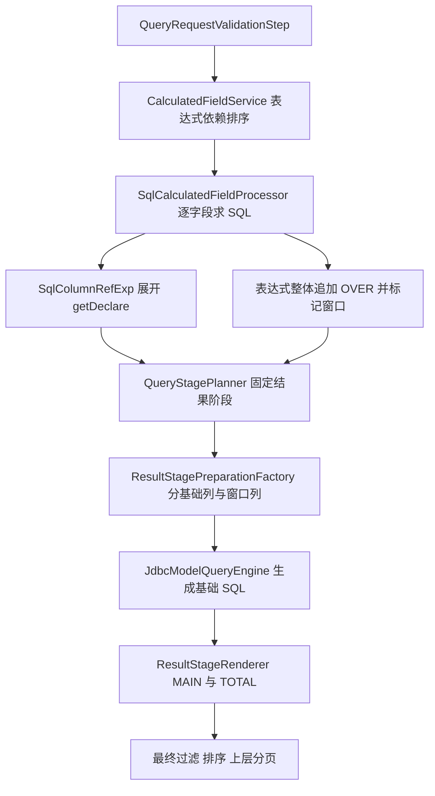

# 窗口计算依赖与结果阶段核心流程 review

本 review 配套 [#142 实施方案](BUG-142-window-calculated-field-stage-plan.md)，检查普通 query_model 从计算字段验证、表达式解析、依赖绑定到阶段规划、投影准备、MAIN/TOTAL 渲染的流程。结论是现有基础结构可复用，但阶段来源、真实输出与字段引用尚未形成完整约束；只传播窗口标志会留下静默错误。

本次为源码静态 review，不包含数据库运行、性能基准或修复测试执行。issue 的数值是报告中的复现证据；新增发现区分当前代码行为与扩展多阶段后才可能触发的风险。当前 HEAD 为 f0deb244，较前次 #140/#141 review 基线新增 #139 路由修复；两基线之间本次检查的表达式/阶段实现未变。没有实施引擎修改。

2026-10-20 补充复核：[issue 的执行前校验与 AI 可修正诊断要求](https://github.com/foggy-projects/foggy-data-mcp-bridge/issues/142)已读取（updatedAt=2026-10-19T17:56:35Z，无评论）。新增 R11～R13，将检查范围延伸到 Runtime 错误映射和修正建议的可执行性，已回写实施方案第 5.3 节及验收范围。

## 1. 当前流程与缺口

拓扑排序顺序并不等于 SQL 执行顺序；注册到解析上下文的计算字段也不等于已经由某个关系输出。当前前端存在显式 DSL_CTE 阶段能力，但普通 calculatedFields 不会因此自动获得同等依赖绑定能力。

## 2. 发现与处置总表

| 编号 | 优先级 | 代码行为或风险 | 本次处置 |
|---|---|---|---|
| R01 | P1 | 计算字段引用展开 SQL，传播聚合状态但缺少阶段产出引用 | 必修：绑定符号与生产阶段 |
| R02 | P1 | OVER 包装整个表达式；窗口识别条件在 processor/planner 不一致 | 必修：窗口调用 AST 与统一能力判断 |
| R03 | P1 | 拓扑只读表达式引用、忽略窗口规格，直接删除同名自引用 | 必修：完整依赖与绑定后循环判断 |
| R04 | P1 | 固定窗口层与最终别名并集不能证明实际输出存在 | 必修：从依赖规划阶段和实际输出 |
| R05 | P1 | 隐藏依赖默认放基础层，生命周期默认止于窗口；公开窗口列为空可 single-pass 回退 | 必修：完整闭包、消费阶段与计划一致性错误 |
| R06 | P1 | renderer 将结果阶段过滤累计到最终层；新增多层后有字段提前删除风险 | 必修：最终过滤合同及真实消费范围 |
| R07 | P2 | 结果阶段表达式采用纯 SQL 工厂；扩展参数化表达式时可能丢绑定 | 必须建立参数保真测试和带绑定传递，不宣称当前 issue 已证实参数丢失 |
| R08 | P1 | 新增阶段类型会影响总数等价性和渲染分派；行数与指标总计不能混同 | 必修相关判断，保护既有 totalData |
| R09 | P2 | 已选聚合别名被显式拒绝；不能只在解析器放行 | 定向调整验证与能力矩阵 |
| R10 | P2 | 部分测试只测错误消息，真实窗口 IT 走显式 DSL_CTE | 增加普通入口数值及公共响应验收 |
| R11 | P1 | Runtime 查询通用 catch 按消息分类，fail helper 的 path 固定为空，explain 也有通用错误映射 | 保留类型化规划诊断，避免错误码、路径与依赖信息被抹掉 |
| R12 | P1 | 输入属性诊断已有结构，但不等于最终阶段校验；直接 execute 不能依赖 validate warning 检查 | 共享阻断校验，测试拒绝路径不进入主/总数 JDBC 查询 |
| R13 | P2 | 初稿聚合别名修正建议没有明确按当前能力生成，且拓扑排序会改变字段顺序 | 补来源路径与能力感知建议，建立修正闭环验收 |

优先级表示本次修复顺序，不表示所有风险均已在数据库复现。以下路径均相对仓库根目录。

## 3. R01 与 R02 表达式绑定和窗口节点

证据：`SqlColumnRefExp.evalValue`（约 76～109 行）调用 getDeclare，复制 referencedColumns 和聚合标志，但没有建立“引用某阶段输出”的对象。`SqlCalculatedFieldProcessor.doProcessCalculatedField`（约 129～166 行）在 partitionBy 或 windowOrderBy 非 null 时包装窗口并设置 needsCteWrapping。`SqlFragment.windowFunction`（约 204 行）将 OVER 追加到 baseSql。

影响：依赖窗口字段的标量表达式可能回到基础聚合层；复合算术的 OVER 位置不合法。单纯追加 hasWindow 传播仍无法区分窗口生产者和窗口后的消费者。

额外边界：QueryStagePlanner 还检查 windowFrame，processor 的入口条件却不含 frame；空列表/non-null 与非空检查也不同。这是已确认的判定差异，具体函数组合是否受影响需测试。统一解析后的窗口规格，不能仅在两个位置各补一个判断。

处置：窗口函数节点与标量节点分别解析，输入引用在阶段确定后绑定；保留 existing emptyDefault 的显式语义。验证内嵌窗口、frame-only/空规格的合法和非法输入，以及普通无窗口公式回归。

## 4. R03 依赖图不能只包含表达式名

证据：`CalculatedFieldService.sortByDependencies`（约 113～215 行）已有 Kahn 排序和循环检测；提取 compiledExp 引用后仅保留计算字段名，并移除 field.getName()。未从窗口分区和排序定义建立依赖。

影响：仅用于 partition/order 的计算字段依赖可能遗漏。当前名称收集并不等价于完整符号绑定；直接保留或删除所有同名边都可能误判已有模型字段与内联别名。

处置：保留排序算法，改其输入为身份绑定后的完整依赖；校验重复定义、未知输入、真正循环及窗口跨层依赖。循环诊断应区分循环成员和仅受循环阻塞的下游。不要为这项修复另建独立 DAG 引擎。

## 5. R04 与 R05 阶段输出和隐藏投影

证据：`QueryStagePlanner.plan`（约 118～135 行）生成单个 window_result，输出由 previousOutputs、窗口别名和 finalOutputAliases 合并。`ResultStagePreparationFactory.build`（约 68～101 行）识别 originalColumns 中的窗口列，将依赖补到 mainBaseColumns，并将隐藏依赖的最后消费阶段设为窗口阶段。

`JdbcModelQueryEngine.generateWithCteWrapping`（约 953～1019 行）依据原始公开投影与窗口别名找窗口字段；如果为空，回退 generateSinglePass。当前正常简单窗口是否触发该分支未复现，但只选择窗口下游字段时不能继续使用这个判据。

影响：输出清单可能声称某别名存在，但没有对应生产表达式；阶段产出的依赖被错误放回基础层；隐藏窗口未公开选择时可能失去 SQL 边界。只修改 renderer 而保留准备逻辑无法修复。

处置：从最终输出、过滤、排序反向求闭包，区分基础依赖与结果阶段依赖。准备图必须生成所有隐藏窗口和标量产出，并验证每个输入在该层可用。计划不一致应报内部编译错误，不能退化执行。

ResultStagePlan.Graph.create 已校验诊断与可执行阶段的一一映射、生产者 ID、消费阶段顺序和层内重复别名，值得复用；它不会从任意 SQL 字符串推导引用可用性，因此需要由已绑定表达式补齐输入/输出验证。

## 6. R06 过滤归属与列生命周期

证据：`ResultStageRenderer.renderCte/renderDerived`（约 85、219 行）收集 stage.filters 后在最终 SELECT 应用；`appendSurvivingSourceColumns/columnsAfterStage`（约 309～343 行）只传递 lastConsumerStageId 晚于当前阶段的列。

当前固定阶段中的最终 postSlice 可以符合这一执行方式，但扩展后不能把“逻辑上登记在窗口层”误读为“已在窗口层过滤”。若该列被标成窗口层最后消费，最终 WHERE 就可能读不到它。该风险来自新增阶段设计，不表述为所有现有 postSlice 已损坏。

处置：本次将 postSlice 明确为最终结果过滤，将依赖保留到最终层；若诊断结构需要标记过滤归属，也必须反映真实执行位置。禁止过滤下推穿过窗口。任意中间过滤能力另行设计，不自动扩大支持。

验收：窗口专用过滤、仅过滤不输出字段、多层 scalar 后过滤、仅排序字段、MAIN/TOTAL 同一行集。保留过滤列到最终 WHERE 不意味着把该列公开输出。

## 7. R07 参数与物理折叠

证据：`ResultStagePreparationFactory.prepareWindowResultStageGraph` 使用 BoundSqlExpression.of(window.column.getDeclare())；renderer 本身则支持从 Column.expression 提取 values。现有窗口字符串可能已内联常量，本次没有证明原 issue 的参数遗失。风险在于新增参数化 AST 后沿用只传 SQL 的转换。

处置：新的窗口节点、标量节点和引用转换必须保留 BoundSqlExpression；测试常量、窗口默认值及最终过滤的参数数量和顺序。不要以手工拼值弥补绑定丢失。

`ResultStageRenderer.collapsibleMainWindow` 会在单窗口无过滤时将结果层折叠到 MAIN 最终 SELECT。可保留这一优化，但多层标量、隐藏窗口或额外消费者存在时必须证明折叠等价；TOTAL 的物理形态可以不同，逻辑行集和计算必须一致。

## 8. R08 总数与指标总计

证据：`QueryStagePlan.requiresWindowResultRenderer` 优先排除 POST_AGGREGATE_STAGE；`allowsPreAggFinalCountEquivalent`（约 122～136 行）按列举的阶段类型检测过滤。renderer 的 isResultStage 也只识别窗口和 post aggregate。新增 enum 不会自动接入这些逻辑。

处置：新增结果标量层时，审查所有 stage-type 分支，包括 JdbcModelQueryEngine.lastBaseStageId、最终投影角色、渲染选择、最终 SQL 保留和计数等价性。过滤归属若改到 FINAL_STAGE，计数优化检查也必须覆盖真实最终过滤，不能仅新增一个 enum 判断。

returnTotal 应计数最终过滤后、分页前的结果；不能将 totalData 指标总计理解成同一件事。保留已有 AVG 状态、distinct 规则及不支持表达式的拒绝行为；不自动 SUM 窗口比率或差额。用 AverageTotalDataResultStageRegressionTest 及 TotalDataAggregatePlanTest 等既有测试作保护性回归。

## 9. R09 验证与入口能力

证据：`QueryRequestValidationStep.validatePostAggregateCalculatedFields`（约 385～418 行）对选中聚合别名引用报 POST_AGGREGATE_CALCULATED_FIELD_UNSUPPORTED，仅放行已有特殊 sugar。`QueryStagePlanner` 明确拒绝窗口与 postAggregateCalculations 混用、无窗口能力和窗口 derived 渲染。

处置：只对本次已规划的窗口及其下游链允许聚合别名，不能删掉整个保护条件。未支持的 aggregate-in-window、窗口套窗口和混用在执行前报清晰错误。沿用 #140/#141 的公共最终准备工作，避免 validate 看一份图、execute 再另猜一份。

这不是前端 DTO 变更；首批不新增公共 stage 参数，也不要求用户手写内部层号。已有 DSL_CTE 与 Compose AST 可复用其函数/窗口规格约定，不将普通查询强制改写成另一个公开入口。

## 10. R10 测试盲区与验收

`SqlCalculatedFieldProcessorWindowOrderTest` 包含括号检测和错误字符串合同测试，不能证明真实引用被正确绑定。`DslCteResultStageWindowIT` 有真实 SQL 与手写 SQL 对照，但测试显式 DSL_CTE 的累计贡献，不能覆盖 ordinary calculatedFields 的跨阶段引用。现有测试可继续保留，不以“已有窗口 IT”代替本问题复现。

本次新增普通入口测试至少检查：原 issue 每月数值、定义乱序、只选末端字段、多层依赖、聚合别名、复合窗口、隐藏过滤和排序、零/null、缺月、多分区、参数、分页和总数。数值测试必须断言字段存在性与可空合同，区分 SQL 的 null 和序列化遗漏字段；不能只断言成功或行数。

集成验证沿用仓库实际 runner，并记录执行的数据库和拒绝能力。此 review 未运行测试，不能继承测试文件注释中的历史“全部通过”作为当前结论。

## 11. 本次合并与延后事项

必须随 #142 合并：阶段引用绑定、完整依赖、窗口节点提取、隐藏输出、最终过滤和参数保真、总数策略接入、验证一致性及真实数值回归。以上已回写实施方案第 4～9 节。

补充要求同时纳入：Runtime 结构化错误映射、原始 JSON 路径保留、直接执行的阻断检查、按当前能力生成修正建议及修正后数值验收；不能只在表达式层追加错误文案。

保护性验证：已有无窗口公式、postAggregateCalculations、DSL_CTE、Compose、totalData 和 #140/#141。共享结果 renderer 的变更必须跑这些路径，但不据此扩展它们的公开能力。

延后：窗口套窗口、任意中间过滤、通用标量内联/层合并优化、无 CTE 方言的新窗口支持、任意 timeWindow 与窗口链组合、通用缓存或预聚合重构。层数可能增加 SQL 长度，首批优先正确性；实施阶段在代表性链深度上观察编译时间和执行计划，不在未测量前承诺性能提升。

与 [#140/#141 核心流程 review](REVIEW-140-141-query-engine-core-flow.md) 的分工：其请求上下文、公共准备和执行结果生命周期改造作为共享基础；本 review 聚焦基础关系之后的字段生产、消费和结果计算，不重复实施 namespace 路由或期间映射。

## 12. 源码定位

以下链接对应本次基线；正文行号为该基线的定位辅助，后续实施应以方法名为准。

- 依赖与表达式：[CalculatedFieldService](../../../foggy-dataset-model-engine/src/main/java/com/foggyframework/dataset/model/engine/expression/CalculatedFieldService.java)、[SqlCalculatedFieldProcessor](../../../foggy-dataset-model-engine/src/main/java/com/foggyframework/dataset/model/engine/expression/SqlCalculatedFieldProcessor.java)、[SqlColumnRefExp](../../../foggy-dataset-model-engine/src/main/java/com/foggyframework/dataset/model/engine/expression/sql/SqlColumnRefExp.java)、[SqlFragment](../../../foggy-dataset-model-engine/src/main/java/com/foggyframework/dataset/model/engine/expression/SqlFragment.java)。
- 规划：[QueryStagePlanner](../../../foggy-dataset-model-engine/src/main/java/com/foggyframework/dataset/model/engine/stage/QueryStagePlanner.java)、[QueryStagePlan](../../../foggy-dataset-model-engine/src/main/java/com/foggyframework/dataset/model/engine/stage/QueryStagePlan.java)、[QueryRequestValidationStep](../../../foggy-dataset-model-engine/src/main/java/com/foggyframework/dataset/model/plugins/result_set_filter/QueryRequestValidationStep.java)。
- 执行结构：[ResultStagePlan](../../../foggy-dataset-model-engine/src/main/java/com/foggyframework/dataset/model/engine/stage/result/ResultStagePlan.java)、[ResultStagePreparationFactory](../../../foggy-dataset-model-engine/src/main/java/com/foggyframework/dataset/model/engine/stage/result/ResultStagePreparationFactory.java)、[ResultStageRenderer](../../../foggy-dataset-model-engine/src/main/java/com/foggyframework/dataset/model/engine/stage/result/ResultStageRenderer.java)、[JdbcModelQueryEngine](../../../foggy-dataset-model-engine/src/main/java/com/foggyframework/dataset/model/engine/JdbcModelQueryEngine.java)。
- 测试：[SqlCalculatedFieldProcessorWindowOrderTest](../../../foggy-dataset-model-engine/src/test/java/com/foggyframework/dataset/model/expression/SqlCalculatedFieldProcessorWindowOrderTest.java)、[DslCteResultStageWindowIT](../../../foggy-dataset-model-engine/src/test/java/com/foggyframework/dataset/model/semantic/DslCteResultStageWindowIT.java)。

## 13. R11 与 R12 结构化错误传递和执行前阻断

新增证据：

- [RuntimeError](../../../foggy-runtime-api/src/main/java/com/foggyframework/runtime/api/dto/RuntimeError.java) 已有 code、phase、field、path、suggestedNextAction、safeToAutoRepair；[RuntimeDiagnostics](../../../foggy-runtime-api/src/main/java/com/foggyframework/runtime/api/dto/RuntimeDiagnostics.java) 有 attributes，可承载依赖/阶段信息，无需另建 envelope。
- [RuntimeQueryController](../../../foggy-runtime-api/src/main/java/com/foggyframework/runtime/api/controller/RuntimeQueryController.java) 的 query 通用 catch 调用 mapQueryError，validate 通过消息关键词归类，execute 默认 QUERY_EXECUTE_FAILED；通用 fail helper 将 path 置 null。这是代码映射行为，不代表所有异常路径都丢失字段。
- 同 controller 仅对 validate response 检查 firstBlockingValidationWarning。最终阶段拒绝不能只添加 warning 并依赖这一检查，否则直接 execute 没有等价保证。
- [RuntimeQueryExplainController](../../../foggy-runtime-api/src/main/java/com/foggyframework/runtime/api/controller/RuntimeQueryExplainController.java) 对规划服务的通用异常映射为 QUERY_EXPLAIN_FAILED 等，需同步接入类型化诊断。
- [QueryInputValidationException](../../../foggy-dataset-model-engine/src/main/java/com/foggyframework/dataset/model/semantic/support/QueryInputValidationException.java) 和 [QueryInputWarning](../../../foggy-dataset-model-engine/src/main/java/com/foggyframework/dataset/model/semantic/domain/QueryInputWarning.java) 已承载输入属性级 violations；这是可参考结构，不能视为已具备阶段校验或直接将阻断错误降成 warning。

处置：公共 prepare 在执行前产出可执行计划或结构化失败；控制器优先映射该失败，内部表达式异常包装不得只保留字符串。保留现有错误协议和脱敏规则；采用 query.validate 表示本次校验失败阶段，实际请求操作放 diagnostics.attributes.requestOperation。不能把当前 controller 按 endpoint 赋 phase 的行为当成已符合新增要求。

对已知不支持组合返回能力错误，对已承诺支持但编译不一致返回内部规划错误。两者都不能执行不可信计划，但后者不应编造用户修正建议。测试既要断言拒绝 envelope，也要使用执行端计数/spy 验证主查询和总数查询没有调用；允许正常模型元数据和权限准备。

## 14. R13 修正建议的语义与路径保真

初稿对 lag(sum(...)) 提示“先声明聚合别名”，但当前普通入口显式拒绝 lag(totalAmount,1)。该建议只有在本次别名支持实际完成后才成立；现阶段应优先采用 issue 已验证的 lag(invoiceAmount,1)，且仍须确认其默认聚合口径等价。已将实施方案改为按当前能力生成建议。

复合窗口拆成 previousAmount 后，如果入口不支持后续阶段，再建议同层 difference 只是换一种错误。只能提供已支持派生阶段的真实最小写法；否则提示先返回本期/上期金额再交计算工具，safeToAutoRepair=false。不得修改范围、分组或排序，也不得推荐物理 SQL 和内部参数。

原始 JSON 路径必须在重排定义及生成隐藏字段之前保存。$.calculatedFields[1].expression 应指用户原来的 difference，不是排序后的第二项；payload/request 包装沿用现有 Query DSL 路径约定。测试打乱定义顺序与多个阻断项，验证路径、field、依赖链一致。

验收增加“建议 → 修正请求 → validate → execute → 数值核对”闭环，并检查业务条件不变。局部修正只有在证明口径、粒度、null 语义相同后才可标记 safeToAutoRepair=true；标记本身不代表允许服务端静默改请求。窗口依赖与内嵌窗口在本次支持完成后应正常通过，不为测试错误码而永久拒绝原 issue A/B。合法首行 null 必须继续是合法结果。

## 实施进展（2026-10-20）

此前“仅讨论/未实施”的文字为方案阶段记录；用户已授权统一实施，当前状态以本节和后续验收记录为准。

R01～R06、R08～R13 对应的 AST 窗口提取、依赖/阶段绑定、隐藏输出、最终过滤、计数、入口校验与类型化诊断已实施。R07 沿用现有表达式常量内联和 BoundSqlExpression/关系过滤参数传递，不引入新的参数化表达式语法；需要结合跨数据库执行与已有渲染参数测试验收，不能声称本次增加了任意 AST 参数能力。

补充复查进一步修正：循环诊断不再把所有未排序字段标为循环成员；原始安全异常通过类型化诊断保留 cause；阶段输出不再预先宣称尚未生成的标量别名存在；Compose 的前置 CTE 内部引用也按已生成的作用域逐层改名。

真实多库验收补齐两项：SQL Server 不允许 `FROM (WITH ... SELECT ...)`，最终结果统计复用结构化 CTE，在顶层组装 WITH，并保持 CTE 参数在外层参数之前。MySQL/SQL Server 对高精度聚合 DECIMAL 除法会缩减小数位；结果阶段比例使用显式近似数因子 `1e0`，比较计划通过 `LiteralExpr.approximate` 明确选择近似数语义。普通 Compose 常量仍保持原来的 SQL 类型，近似标记参与表达式相等与缓存身份，新增保护性断言。金额及差额仍使用原生聚合数值类型，分母零继续返回 null；比例以 double 容差做跨库验收，不把比例承诺为任意精度十进制。

必需后端全量测试已通过。完整结果、初轮问题的收尾修复和现行门禁见 [最终验收记录](VERIFICATION-140-141-142.md)；不将实际 Maven 执行结果冒充历史发布门禁通过。

## 最终验收（2026-10-20）

实现与本次必须合并的核心流程调整已完成。Windows/Linux 全量单测各 5,842 项，均无失败和错误；常规集成、五库矩阵及外部服务共 926 次测试执行，零失败、零错误、零跳过。后续收尾已修复 Viewer E2E 失配、补跑真实 MySQL 浏览器链路（5/5、零跳过），并恢复两个源码扫描的正式 JUnit 执行。当前版本沿用 current-main 本地验收门禁，V934 历史清单保持原样。详见 [最终验收记录](VERIFICATION-140-141-142.md)。
